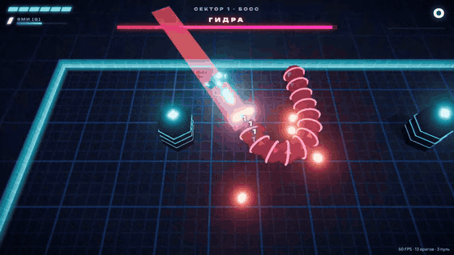
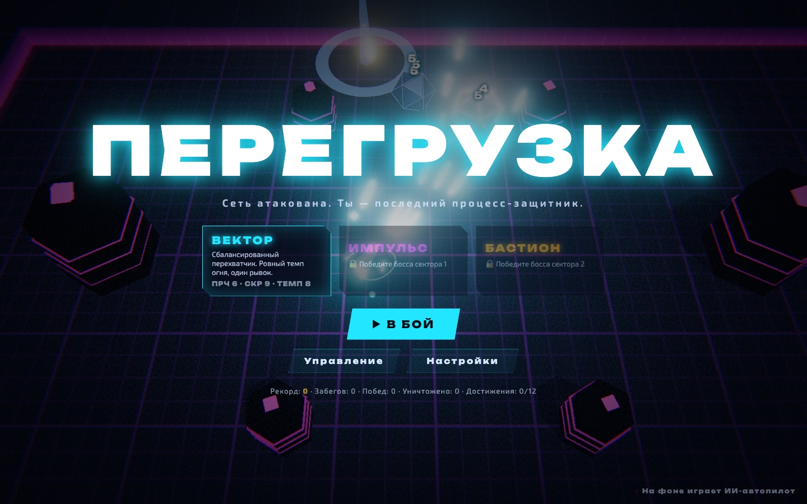
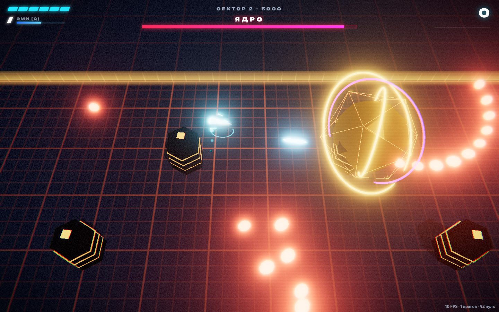
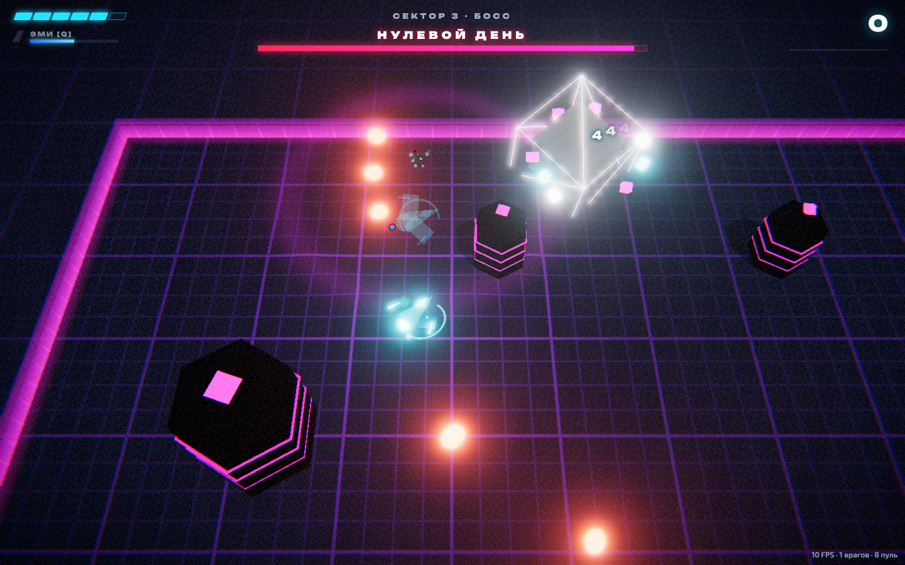

# ПЕРЕГРУЗКА

**Неоновый 3D-шутер-рогалик на арене внутри компьютерной сети.**
Игру целиком и автономно, за одну сессию, сделал ИИ: Claude Opus 5.5 в Claude Code. Все модели, текстуры, музыка и звуки сгенерированы кодом: ни одной модели, текстуры или звука со стороны (только шрифты — Google Fonts).

### ▶ [Играть: sergbobrov.github.io/game-prototype](https://sergbobrov.github.io/game-prototype/)



| Меню (на фоне играет ИИ-автопилот) | Босс «Ядро» | Босс «Нулевой день» |
|---|---|---|
|  |  |  |

---

## Что это за игра

Ты — боевой дрон-процесс в атакованной сети. Тебя ждут три сектора по пять волн, в конце каждого сектора — босс. После каждой волны ты выбираешь один модуль из трёх, и из модулей собирается твой билд. Если погибнешь, забег начинается заново.

- **7 типов вирусов, у каждого своё поведение:**
  - **Бит** — стайный рой, летит по правилам boids и лопается при таране.
  - **Таран** — показывает полосу будущего рывка и врезается.
  - **Прицел** — снайпер, ведёт лазер, затем стреляет.
  - **Улей** — выпускает рой.
  - **Эгида** — щит спереди; щит можно продавить или обойти с фланга.
  - **Делитель** — при гибели делится на два, дважды.
  - **Мина** — взводится рядом с тобой. Мины взрывают друг друга цепной реакцией.
- **3 босса с фазами:**
  - **Гидра** — змей из 12 сегментов; голову бронируют сегменты, пока живы.
  - **Ядро** — спирали пуль, кольцевые залпы и вращающиеся лазеры.
  - **Нулевой день** — телепорты с глитчем, крест из лазеров, призыв врагов и финальная ярость.
- **20 модулей со связками:** веер, пробой, рикошет, наведение, цепная молния, разрывные пули, дроны-спутники, ракеты, щит, клинок рывка, «Фокус» с замедлением времени и другие. Если у тебя уже есть модуль с таким же тегом, тег на новой карте подсвечивается зелёным: это связка.
- **3 корабля:**
  - «Вектор» — сбалансированный, доступен сразу.
  - «Импульс» — быстрый, с двумя рывками; открывается победой над первым боссом.
  - «Бастион» — дробовик со щитом; открывается победой над вторым боссом.
- **Прогресс между забегами:** 12 достижений, рекорды, статистика.
- **Ощущение удара:** тысячи частиц, побеждённые враги рассыпаются на кубики, по полу от взрывов расходятся волны и искривляют сетку. На мощных ударах кадр замирает, после убийства босса время замедляется. Есть тряска камеры, хроматическая аберрация, глитч экрана при смене фазы босса и всплывающие цифры урона.
- **Процедурный синтвейв:** у каждого сектора своя тональность. Музыка набирает слои по мере накала боя, а в замедлении уходит под фильтр.
- **ИИ-автопилот** играет сам на фоне главного меню.

## Управление

| | |
|---|---|
| `W A S D` / стрелки | движение (работает на любой раскладке, в том числе на русской) |
| мышь | прицел |
| ЛКМ (удерживать) | огонь · `F` — автоогонь |
| `Пробел` / ПКМ / `Shift` | рывок, на время рывка ты неуязвим |
| `Q` | ЭМИ-волна: стирает пули, оглушает и отбрасывает врагов. Заряжается от собранных данных |
| `Esc` | пауза и настройки |
| 🎮 геймпад | левый стик — движение, правый — прицел и огонь, A — рывок, RB — ЭМИ |

Красные полосы, лазеры и круги на полу предупреждают об атаке. Уходи рывком.

## Как установить как приложение

- **Компьютер, Chrome или Edge:** нажми значок «Установить» справа в адресной строке. Игра откроется в отдельном окне, как обычная программа.
- **iPad или iPhone, Safari:** «Поделиться» → «На экран „Домой“». Игра рассчитана на клавиатуру и мышь, тач-управления пока нет.

После первого запуска игра работает без интернета: это проверено автотестом.

---

## Как это сделано

**Стек:** TypeScript, [three.js](https://threejs.org) (WebGL), Vite, Web Audio API, Vitest, Playwright, GitHub Pages и GitHub Actions. Всего около 6300 строк кода.

**Ноль ассетов.**
- **Модели:** корабли, враги и боссы собраны кодом из примитивов, у врагов есть каркасы со свечением.
- **Арена:** пол — собственный GLSL-шейдер. Это сетка с волнами от взрывов, подсветкой вокруг игрока и пульсом в такт музыке.
- **Звук:** музыка и все звуки синтезированы в реальном времени через Web Audio.
- **Иконки:** нарисованы как SVG и отрендерены в PNG через Playwright.

**Архитектура:**

```
src/sim/    симуляция без графики: мир, враги, боссы, волны, модули (детерминированная, seed → тот же забег)
src/view/   three.js: шейдер арены, инстансинг врагов и пуль, частицы, обломки, постобработка, камера
src/audio/  процедурный звук: секвенсор и синтез эффектов
src/bot/    ИИ-автопилот (steering behaviours: уклонение от пуль, лазеров и полос рывка)
src/ui/     интерфейс боя, карты модулей, меню, экраны итогов
tools/      баланс без браузера, скриншоты, офлайн-тест, запись видео, генерация иконок
```

Симуляция отделена от графики. Благодаря этому один и тот же код:
- рисуется в браузере;
- гоняется ботом без браузера, по 50 забегов за 25 секунд;
- проверяется юнит-тестами.

## Баланс — по данным бота

Автопилот (навык 0.9) сыграл по 50 полных забегов на каждом корабле, без графики:

| Корабль | Побед из 50 | Боссов в среднем | Средняя длина забега |
|---|---|---|---|
| Вектор | 8 | 1.94 | 11 мин |
| Импульс | 7 | 1.80 | 10 мин |
| Бастион | 13 | 2.20 | 16 мин |

Главная стена — финальный босс: на нём заканчивается около 60% забегов. Бот видит каждую пулю заранее, поэтому живому игроку будет труднее. Обычные волны сложнее, чем по цифрам бота.

Как с помощью бота найдены и исправлены проблемы:
- Боссы умирали за 5–10 секунд, потому что урон игрока растёт от модулей в 4–5 раз. Ввёл оценку силы билда, и прочность врагов частично под неё подстраивается.
- Бот застревал на «Эгиде»: щит всегда смотрит на игрока, и в лоб её не пробить. Теперь у щита свой запас прочности, его можно продавить.
- Крест из лазеров финального босса убивал почти всегда. Лазеров стало меньше, вращение медленнее.

## Проверка

- **Юнит-тесты симуляции:** волны идут, все три босса убиваемы, модули применяются, симуляция детерминирована.
- **Скриншоты в Playwright:** headless Chromium, меню и все боссы, ноль ошибок в консоли.
- **Настоящий Chrome на настоящей видеокарте:**
  - 60 FPS;
  - ввод проверен с русской раскладкой: событие `KeyW` с буквой «ц» двигает корабль;
  - пройден весь цикл кликами: меню → бой → пауза → карты модулей → смерть → «Ещё раз».
- **Офлайн:** после первой загрузки страница перезагружается без сети.

## Журнал решений

1. **Сначала была тактика.** По первому брифу я начал пошаговый тактический рогалик для iPhone и iPad в духе Into the Breach.
2. **Разворот.** Потом заказчик уточнил, что нужен максимальный «вау» от автономного ИИ, а платформа не важна. Тихое «вау» тактики проигрывает 3D-экшену в реальном времени, поэтому я выбрал шутер на арене. Тактическое ядро не пропало: оно лежит в архиве сессии, в репозиторий не попало.
3. **Платформа — десктопный Chrome, плюс PWA.** У компьютера больше ресурсов под эффекты, клавиатура и мышь дают точное управление.
4. **Порядок работы.** Сначала заработал деплой, затем играбельное ядро на сайте, и только потом шло расширение. Каждый этап сразу выкладывался.
5. **Звук делал субагент.** Звуковой модуль с заранее оговорённым интерфейсом писал отдельный субагент параллельно с основной работой. Остальной код написан в одном потоке.

## Честные ограничения

- **Звук написан вслепую.** Музыку и эффекты никто не слушал: ИИ звука не слышит, проверено только, что звук запускается и пульсирует в темп. Если что-то звучит плохо, громкость регулируется в настройках.
- **Тач-управления нет**, игра рассчитана на клавиатуру и мышь или геймпад.
- **Баланс подобран по боту**, живые игроки могут ощутить сложность иначе.

## Разработка

```bash
npm install
npm run dev                          # локальный сервер
npm test                             # юнит-тесты симуляции
npm run build                        # типы + сборка в dist/
npx tsx tools/balance.ts 50 vector   # 50 забегов бота без графики
node tools/shoot.mjs <url> shots     # скриншоты и проверка консоли
node tools/offline.mjs <url>         # офлайн-тест
```

Параметры адреса для отладки: `?autoplay=1` — играет бот, `?play=1` — сразу в бой, `?sector=1&wave=5` — сразу к боссу второго сектора, `?fps=1` — счётчик FPS.

Шрифты Unbounded и Exo 2 — Google Fonts.
